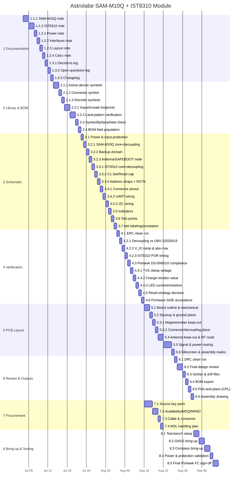

# Gantt Chart: Astrolabe SAM-M10Q + IST8310 Pixhawk GPS/Compass Module

Schedule derived from `WBS_Astrolabe_SAM-M10.md`. Leaf work packages only (summary nodes are shown as sections, not scheduled bars).

**Assumptions** (from your inputs — adjust any and I'll reflow):
- **Start:** 2026-07-03 · **Resourcing:** solo engineer → work is a mostly-sequential chain.
- **One parallel branch:** Procurement (§7) runs alongside Layout/Review, since part sourcing is mostly lead-time, not bench effort.
- **Calendar model:** continuous days (weekends *not* excluded). If you work weekdays only, the finish shifts out ~4 weeks — say the word and I'll switch to a weekday-excluded calendar.
- **Durations are my recommendations** for a solo engineer to review, not measured estimates.
- **Projected finish: 2026-09-11** (~10 weeks / 71 days).

**Critical path:** Documentation → Library → Schematic → Verification → Layout → Review & Outputs → Testing. Procurement is *not* on the critical path (finishes 08-22, well before testing starts). The whole main chain is critical because a solo engineer can't parallelize effort — the fastest lever on the end date is shortening tasks on this chain, not adding branches.

## Activity schedule (fallback table)

Dates are inclusive (End = last working day of the activity). Duration in calendar days.

| ID | WBS | Activity | Dur | Start | End | Depends on |
|----|-----|----------|-----|-------|-----|-----------|
| a1 | 1.1.1 | SAM-M10Q note | 2d | 2026-07-03 | 2026-07-04 | — |
| a2 | 1.1.2 | IST8310 note | 2d | 2026-07-05 | 2026-07-06 | a1 |
| a3 | 1.2.1 | Power note | 1d | 2026-07-07 | 2026-07-07 | a2 |
| a4 | 1.2.2 | Interfaces note | 1d | 2026-07-08 | 2026-07-08 | a3 |
| a5 | 1.2.3 | Layout note | 1d | 2026-07-09 | 2026-07-09 | a4 |
| a6 | 1.2.4 | Calcs note | 1d | 2026-07-10 | 2026-07-10 | a5 |
| a7 | 1.3.1 | Decisions log | 1d | 2026-07-11 | 2026-07-11 | a6 |
| a8 | 1.3.2 | Open-questions log | 1d | 2026-07-12 | 2026-07-12 | a7 |
| a9 | 1.3.3 | Changelog | 1d | 2026-07-13 | 2026-07-13 | a8 |
| b1 | 2.1.1 | Active-device symbols | 2d | 2026-07-14 | 2026-07-15 | a9 |
| b2 | 2.1.2 | Connector symbol | 1d | 2026-07-16 | 2026-07-16 | b1 |
| b3 | 2.1.3 | Discrete symbols | 1d | 2026-07-17 | 2026-07-17 | b2 |
| b4 | 2.2.1 | Import/create footprints | 2d | 2026-07-18 | 2026-07-19 | b3 |
| b5 | 2.2.2 | Land-pattern verification | 2d | 2026-07-20 | 2026-07-21 | b4 |
| b6 | 2.3 | Symbol/footprint/datasheet cross-check | 1d | 2026-07-22 | 2026-07-22 | b5 |
| b7 | 2.4 | BOM field population | 1d | 2026-07-23 | 2026-07-23 | b6 |
| c1 | 3.1 | Power supply & input protection | 1d | 2026-07-24 | 2026-07-24 | b7 |
| c2 | 3.2.1 | SAM-M10Q core + decoupling | 1d | 2026-07-25 | 2026-07-25 | c1 |
| c3 | 3.2.2 | Backup domain | 1d | 2026-07-26 | 2026-07-26 | c2 |
| c4 | 3.2.3 | Antenna net + SAFEBOOT_N node | 1d | 2026-07-27 | 2026-07-27 | c3 |
| c5 | 3.3.1 | IST8310 core + decoupling | 1d | 2026-07-28 | 2026-07-28 | c4 |
| c6 | 3.3.2 | C1 Set/Reset cap | 1d | 2026-07-29 | 2026-07-29 | c5 |
| c7 | 3.3.3 | Address straps + RSTN | 1d | 2026-07-30 | 2026-07-30 | c6 |
| c8 | 3.4.1 | Connector pinout | 1d | 2026-07-31 | 2026-07-31 | c7 |
| c9 | 3.4.2 | UART wiring (crossover on module) | 1d | 2026-08-01 | 2026-08-01 | c8 |
| c10 | 3.4.3 | I2C wiring | 1d | 2026-08-02 | 2026-08-02 | c9 |
| c11 | 3.5 | Indicators | 1d | 2026-08-03 | 2026-08-03 | c10 |
| c12 | 3.6 | Test points | 1d | 2026-08-04 | 2026-08-04 | c11 |
| c13 | 3.7 | Net labeling & annotation | 1d | 2026-08-05 | 2026-08-05 | c12 |
| d1 | 4.1 | ERC clean run | 1d | 2026-08-06 | 2026-08-06 | c13 |
| d2 | 4.2.1 | Decoupling vs UBX-22020019 | 1d | 2026-08-07 | 2026-08-07 | d1 |
| d3 | 4.2.2 | V_IO ramp & abs-max | 1d | 2026-08-08 | 2026-08-08 | d2 |
| d4 | 4.2.3 | IST8310 POR timing | 1d | 2026-08-09 | 2026-08-09 | d3 |
| d5 | 4.3 | Pixhawk DS-009/010 compliance | 1d | 2026-08-10 | 2026-08-10 | d4 |
| d6 | 4.4.1 | TVS clamp voltage | 1d | 2026-08-11 | 2026-08-11 | d5 |
| d7 | 4.4.2 | Charge-resistor value | 1d | 2026-08-12 | 2026-08-12 | d6 |
| d8 | 4.4.3 | LED currents/resistors | 1d | 2026-08-13 | 2026-08-13 | d7 |
| d9 | 4.5 | Reset-strategy decision | 1d | 2026-08-14 | 2026-08-14 | d8 |
| d10 | 4.6 | Firmware 0x0E acceptance | 1d | 2026-08-15 | 2026-08-15 | d9 |
| e1 | 5.1 | Board outline & mechanical | 2d | 2026-08-16 | 2026-08-17 | d10 |
| e2 | 5.2 | Stackup & ground plane | 1d | 2026-08-18 | 2026-08-18 | e1 |
| e3 | 5.3.1 | Magnetometer keep-out | 1d | 2026-08-19 | 2026-08-19 | e2 |
| e4 | 5.3.2 | Connector position / decoupling proximity | 1d | 2026-08-20 | 2026-08-20 | e3 |
| e5 | 5.4 | Antenna keep-out & RF routing | 2d | 2026-08-21 | 2026-08-22 | e4 |
| e6 | 5.5 | Signal & power routing | 3d | 2026-08-23 | 2026-08-25 | e5 |
| e7 | 5.6 | Silkscreen & assembly markings | 1d | 2026-08-26 | 2026-08-26 | e6 |
| f1 | 6.1 | DRC clean run | 1d | 2026-08-27 | 2026-08-27 | e7 |
| f2 | 6.2 | Final design review | 2d | 2026-08-28 | 2026-08-29 | f1 |
| f3 | 6.3 | Gerber & drill files | 1d | 2026-08-30 | 2026-08-30 | f2 |
| f4 | 6.4 | BOM export | 1d | 2026-08-31 | 2026-08-31 | f3 |
| f5 | 6.5 | Pick-and-place (CPL) | 1d | 2026-09-01 | 2026-09-01 | f4 |
| f6 | 6.6 | Assembly drawing | 1d | 2026-09-02 | 2026-09-02 | f5 |
| g1 | 7.1 | Source key parts | 3d | 2026-08-16 | 2026-08-18 | d10 |
| g2 | 7.2 | Availability / MOQ / NRND | 2d | 2026-08-19 | 2026-08-20 | g1 |
| g3 | 7.3 | Cable & connector | 1d | 2026-08-21 | 2026-08-21 | g2 |
| g4 | 7.4 | MSL handling plan | 1d | 2026-08-22 | 2026-08-22 | g3 |
| h1 | 8.1 | Test-bench setup | 2d | 2026-09-03 | 2026-09-04 | f6, g4 |
| h2 | 8.2 | GNSS bring-up | 2d | 2026-09-05 | 2026-09-06 | h1 |
| h3 | 8.3 | Compass bring-up | 2d | 2026-09-07 | 2026-09-08 | h2 |
| h4 | 8.4 | Power & protection validation | 1d | 2026-09-09 | 2026-09-09 | h3 |
| h5 | 8.5 | Final Pixhawk FC sign-off | 2d | 2026-09-10 | 2026-09-11 | h4 |

**Projected completion: 2026-09-11.**

---

### Notes on the schedule
- **Board fabrication lead time is not modeled.** The WBS has no board-fab task, so testing (§8) starts right after fab outputs (§6). In reality, insert a fab/shipping gap (typically 1–3 weeks) between 6.6 and 8.1. Tell me if you'd like it added.
- **Procurement float:** Procurement finishes 08-22 but testing doesn't start until 09-03, so parts have ~11 days of slack. If real part lead times (supercap, SAM-M10Q) run long, 7.1 is where to start early.
- Many verification and schematic sub-tasks are budgeted at 1 day as a floor; several are genuinely a few hours. If you'd rather collapse the sub-items (e.g., treat all of §4.2 as one 2-day block), I can regroup.
